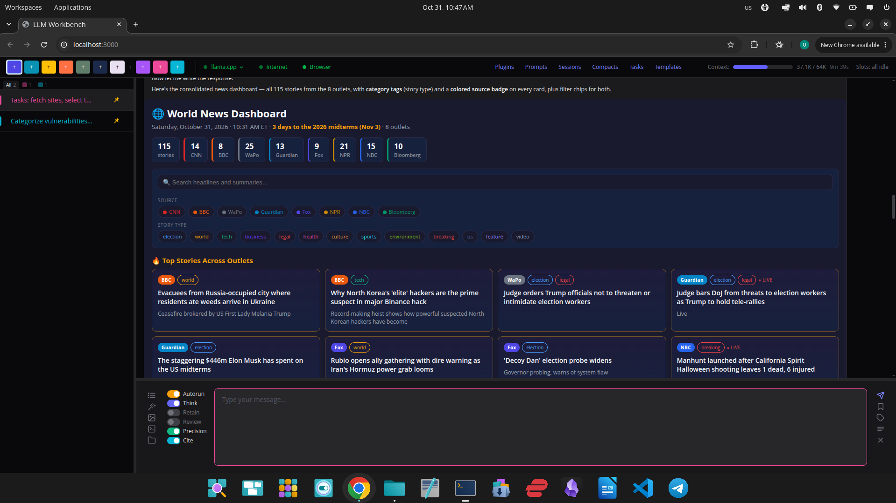

# lumispec.ai

> A local-first AI workbench. Chat with your own LLM, point it at your codebase, your portfolio, the web, your travel plans — and let it do the work end to end.

<p align="center">
  
  <br><sub>A task pipeline fetches eight outlets through Browser Search (<code>web_fetch</code> in a hidden tab of your own Chrome), and the model renders all 115 stories as an inline HTML applet with source badges, topic tags and filter chips.</sub>
</p>

Connect any [llama.cpp](https://github.com/ggerganov/llama.cpp)-compatible model and get a full chat UI with web search, Python execution, code editing, interactive visualizations, deep E\*TRADE integration, and a task-pipeline runner — all running on your hardware. No cloud dependencies, no telemetry, no per-token bill.

---

## ⚡ Choosing a slot layout for llama-server

A **slot** is one conversation the server can generate for at a time. More slots mean more
conversations answering at the same moment; each slot also costs VRAM. There are two layouts worth
running, and which one fits is decided by your card.

| | **One slot** — recommended | **Four slots, a window each** |
|---|---|---|
| For | 24–32 GB cards (RTX 5090) | 48 GB and up (RTX PRO 6000, 96 GB) |
| Flags | `--parallel 1 --ctx-size 114688` | `--parallel 4 --no-kv-unified --ctx-size 458752` |
| Window per conversation | 112K tokens | 112K tokens each |
| Conversations generating at once | 1 — the others wait their turn | up to 4 |
| Returning to an earlier conversation | fast: restored from the server's RAM cache | fast: still in its own slot |
| VRAM with a 27B model at Q6 | 30.0 GB (measured) | about 44 GB (server's own projection) |

### One slot (recommended)

```bash
  --ctx-size 114688 \
  --parallel 1 \
  --flash-attn on \
  --cache-type-k q8_0 \
  --cache-type-v q8_0 \
```

- **Why we recommend it.** On a 32 GB card it is the only way to a 112K window, and a large
  window is what this app's long tool runs, big pages, book sections and pipeline steps need. The
  tool loop winds down at 80% of the window: about 92K tokens here, against 51K at 64K.
- **What you give up.** Two conversations generating at the same moment. A turn started while
  another is running waits for the slot.
- **Switching conversations stays cheap.** The server saves the idle conversation to system RAM
  (8 GB limit by default) and restores it: going back and forth between two 3.7K-token
  conversations re-processed 4 tokens per switch.
- **Measured:** llama-server holds 30.0 GB (30.9 GB on the card with a desktop running). One
  99,071-token prompt was processed in 52 s.

### Four slots, a window each (large cards)

```bash
  --ctx-size 458752 \
  --parallel 4 \
  --no-kv-unified \
  --flash-attn on \
  --cache-type-k q8_0 \
  --cache-type-v q8_0 \
```

- **What it gives.** Four conversations generate in parallel, each with its own 112K window, and
  each keeps its cache in its own slot. This is the layout the app's "conversations keep running
  when you switch" feature was built for: every running conversation shows on the Slots panel.
- **`--ctx-size` is the total.** With `--no-kv-unified` the server divides it by the slot count:
  458752 ÷ 4 = 114688 per slot. `--parallel 4 --kv-unified-per-slot 114688` (no `--ctx-size`)
  builds the same thing.
- **What it costs.** The server projects 44.6 GB for this layout with a 27B model at Q6: four
  windows of KV cache (17 GB) and four slots' recurrent state (2.4 GB) on top of the weights.
  Comfortable on 48 GB and up; impossible on 32 GB.
- **On a 96 GB card you can go to the model's limit.** Four windows of 262,144 tokens (the
  model's full training context, `--ctx-size 1048576`) come to roughly 67 GB by the sizing rule
  below. Estimated, not measured — we do not have that card.
- **Parallel is not faster per conversation.** The slots share one GPU; two generating at once
  each run slower than one alone.

### Not recommended: the default (no `--parallel`)

Left to itself, llama-server starts 4 slots that **share one pool** of `--ctx-size` tokens
(`kv_unified = true` in its startup log). Every slot reports the full size because any one slot
may use all of it, but they do not get that much each, and an idle conversation is cleared from
the pool whenever another slot starts a task. With this app, which addresses each conversation's
slot by number, returning to a conversation then re-processed the whole prompt (3,701 of 3,701
tokens in the same test). It works — `--ctx-size 64000` this way holds 29.6 GB and was this
project's layout for months — but you pay four slots' VRAM for a window no bigger than one slot's.

### Sizing rule

For a 27B Qwen3.8 at Q6 with `q8_0` KV cache and the MTP draft, VRAM is close to:

**24.7 GB of weights + 0.6 GB per slot + 37 MB per 1,000 tokens of window per slot + 0.5 GB**

| Layout | Flags | VRAM |
|---|---|---|
| 1 × 64K | `--parallel 1 --ctx-size 64000` | ~28.2 GB (by the rule) |
| 1 × 112K | `--parallel 1 --ctx-size 114688` | 30.0 GB (measured) |
| 4 slots sharing 64K (default) | `--ctx-size 64000` | 29.6 GB (measured) |
| 4 slots sharing 112K | `--ctx-size 114688` | does not fit 32 GB (out of memory at load) |
| 4 × 112K | `--parallel 4 --no-kv-unified --ctx-size 458752` | ~44.6 GB (server's projection) |
| 4 × 262K | `--parallel 4 --no-kv-unified --ctx-size 1048576` | ~67 GB (by the rule) |

Lower `--ctx-size` if the server fails to allocate; a different model or quant changes the first
term. **The app needs no change for any of these**: the tool loops read the live slot's window, so
the budget follows the flags. If you set `LLAMA_MAX_CONTEXT` in `.env`, keep it at or below the
per-slot window.

Measured 2026-11-14 on an RTX 5090 with the Defiance `Q6_K_P` weights (25.9 GB file) on llama.cpp
build 11719 (`5aeac37a3`). Apply the flags to either launch script in
[Choosing & running your model](#-choosing--running-your-model). Change one flag at a time and
watch `journalctl -k | grep Xid` — see the stability note in that section.

---

## 📚 v1.6.0 — Read a book with it

- **Books** *(new, off by default)* — point Lumispec at a folder of Markdown or text files, a single file, or a PDF. It indexes the book in the background, you make it the **open book**, and the assistant searches it before any other tool, answers from it, and names the section each answer rests on. Questions work before indexing finishes. **Book only** withholds every other tool, so the answer is "not in this book" instead of a web search. See "Add Books" below and [`docs/BOOKS.md`](docs/BOOKS.md).
- **PDF books.** A PDF is converted to Markdown in seconds — headings from the PDF's own outline, code fenced, running headers and page numbers dropped — then indexed; the card reports "Step 1 of 2" and "Step 2 of 2". 690 pages converted in 1.4 s. Needs PyMuPDF in the Python environment.
- **Troubleshoot on any answer.** *Revise an answer against its own evidence instead of rerunning it.* A red Troubleshoot on every assistant answer names the answer, quotes the text you selected, reports which tools failed, fell back or were truncated, and has the model read back what its tools actually returned before it corrects anything. Works on good runs too ("verify these numbers"). See [`docs/TROUBLESHOOT.md`](docs/TROUBLESHOOT.md) and [`releases/1.6.0.md`](releases/1.6.0.md).

## 🛠 v1.5.8 — The model can troubleshoot its own applets

- **Troubleshoot button.** Under every applet: it fills the prompt with your problem line, what the browser saw inside the applet (JavaScript errors, failed fetches, rendered height, visible text) and the call that lets the model read back the code it wrote — earlier applets reach it only as `[Applet: html visualization]`, so a "fix" used to be a rewrite from memory. The new always-on `conversation_read` tool returns an earlier answer's applet source, tool results or reasoning.
- **An applet is never clipped.** The frame is sized to the larger of what the applet asks for and what it renders. See [`releases/1.5.8.md`](releases/1.5.8.md).

## 🔀 v1.5.7 — A running answer survives leaving its conversation

- **Conversations keep running.** Switching to another conversation or starting a new chat no longer aborts the turn in flight: it keeps going on its own slot, its live bubble is back when you return, and a pulsing dot in the sidebar marks every conversation that is working. Send, Stop and the timer follow the conversation on screen. A stopped turn is now stored with its reasoning and tool results instead of an empty message.
- **Applets fit the chat area.** Charts, SVGs and images are capped to the visible chat height (a Chart.js canvas used to render 1,763px tall in a 625px area), and the prompt box keeps the height you dragged it to. See [`releases/1.5.7.md`](releases/1.5.7.md).

## 🧱 v1.5.6 — One tool result can no longer sink a turn

- **Tool result limits.** `tree` is summarized over 300 files (layout with counts, first 300 paths, optional `path` for one subdirectory); every tool result is capped at 50K chars; and the context wind-down now cuts the newest results too until the prompt fits. A 7,000-file tree used to make the next request 131K tokens against a 64K slot. See [`releases/1.5.6.md`](releases/1.5.6.md).

## 🐍 v1.5.5 — Python environment detected, per-answer token cap

- **Python environment.** `PYTHON_VENV` may be a venv, uv, pyenv or conda directory, or unset. The app detects which, activates it for `run_python` and `source_run`, and tells the model the install command that works there — a `pip install` aimed at the system Python is refused with the right one.
- **Per-answer token cap.** `LLAMA_MAX_COMPLETION_TOKENS` (default 24576) bounds every streaming answer so a runaway ends in minutes, not at the context wall.
- Template runs are titled "Template: name"; the template review no longer calls a clock static. See [`releases/1.5.5.md`](releases/1.5.5.md).

## 📄 v1.5.4 — Templates reviewed on save, notes apart from the HTML, parse guard

- **LLM review on save.** Every saved template is audited and reviewed in the background; ⚡ runs it again. A review answer must still parse — the model broke the same regex literal twice in a day, and the guard kept the original.
- **Author notes out of the HTML.** A template's leading comment is stored as notes, shown to the model outside the code fence and never copied into the applet. Existing templates migrate on first load.
- **Sidebar title filter** and a `/api/yahoo` proxy for applets. See [`releases/1.5.4.md`](releases/1.5.4.md).

## 🎚 v1.5.3 — The research budget is a setting; Claude tool rounds fixed

- **Research budget on the card.** "Maximum 3 web_search calls and 3 web_fetch calls per user question" was a fixed sentence in the Web Research prompt that the model narrates back as its "budget" — nothing in the tool loop enforces it. It is now **Max searches per question** / **Max fetches per question** on both the Web Search & Fetch and Browser Search cards (0–10, default 3 / 3; `0` removes that half of the sentence). Defaults leave the system prompt byte-identical.
- **Templates fetch every source they name.** A `[template: name]` refresh no longer weighs the budget against the template's own source list (the eight-outlet World NEWS template was about to be refilled from three); a failed source is reported, not filled from memory.
- **Claude backend tool rounds.** Native `<invoke>`/`<parameter>` calls are parsed instead of burning a repair round; calls dropped by the 4-per-round cap are named to the model so it can re-issue them (11 calls used to lose 7 unannounced); `etrade_account` calls are logged once. No reload. See [`releases/1.5.3.md`](releases/1.5.3.md).

## 🐛 v1.5.2 — Clipped pipeline hand-offs are no longer silent

- A task-pipeline step receives the previous step's output capped at 32K chars; a subtask group's outputs are merged **before** the cap, so a wide fan-out lost its last siblings whole and the model never said so (13 fetched outlets → 7½ received → "8 outlets" presented, 2026-11-03). The clip is now announced three ways: a server warning naming the cut and dropped sections, a persistent amber line under the step in the chat, and a `> ⚠` notice at the top of the model's context telling it to state what is missing. Cap unchanged (`MAX_PREV_RESULT_CHARS`, now in `.env.example`). Also ships the **World NEWS** dashboard template from the screenshot above. No reload. See [`releases/1.5.2.md`](releases/1.5.2.md).

## 🐛 v1.5.1 — Bing fix

- Bing searches through Browser Search answered only the first word of every query (`count=10` made Bing serve a stripped entity page). Dropped; ten correct results per query again. One-line patch, no reload. See [`releases/1.5.1.md`](releases/1.5.1.md).

## ✨ v1.5.0 — Your browser, read two new ways

- 👁️ **`web_fetch` `view: "text"`** *(new)* — besides the default `article` view (Readability, or the headline list on a front page), the model can ask for a page as it is laid out on screen: one line per visual row, hidden tooltips and labels excluded, grid cells joined with ` · `. Built for web applications — a Gmail inbox row is 142 characters in text view versus ~500 as markdown, so "list my top 70 subjects" costs about three fetches instead of nineteen; Google News reads five times denser. When Chrome has not laid the page out (inactive tabs skip layout for virtualized lists), a computed-style walker reads it instead.
- 🗂️ **Tab Fetch** *(new, off by default)* — open and prepare a page yourself (login, two-factor, a CAPTCHA you passed, filters, scrolling), then say "look at this" or "look at my Chase tab". With **Let the assistant read my open tabs** on, the model lists your open tabs and reads the one you named **in place** — never navigated, clicked, typed in, scrolled or closed. If two tabs could be the one you meant, it asks; each read asks for your approval unless you turn that off, and autorun never bypasses it. The hidden-tab fetch stays the default; an address you already have open is read from your tab instead of loaded again. Design: [`docs/TAB_FETCH.md`](docs/TAB_FETCH.md). Extension 0.7.0, **reload required**. See [`releases/1.5.0.md`](releases/1.5.0.md).

Everything else is as in v1.4.2:

## ✨ v1.4.2 — Web fetch fixes

- 🌐 **Index pages as headline lists** *(fixed)* — homepages, section fronts and date archives used to come back as summaries with every headline missing (Readability prunes link-wrapped headlines as "related links": NYT 0 of 91 kept, Reuters 0 of 90). They are now detected generically and rendered as `- [headline](url) — summary` lines; article pages are untouched. `<template>` blocks that turned the NYT homepage into 0 chars are stripped first.
- 🧩 **Browser Search extension v0.5.0** *(reload required)* — strips scripts, styles and templates before its size cap (Gmail's inline CSS used to swallow the whole cap before the body), reads a page until its visible text stops growing instead of at the first 200 characters, and **never trades a page Chrome rendered for a cookie-less HTTP re-fetch** — which is how a signed-in Gmail became a "you are logged out" login screen. CAPTCHAs inside an iframe (DataDome) are named instead of reported as "11 chars of content".
- 📏 **Max chars per fetched page** *(new setting)* — default 4000 as before, 1000–50000, on both the Web Search & Fetch and Browser Search cards. Pages the extractor cannot read are saved under `logs/browser-debug/`; a card toggle can save every fetch for parser work.
- 🎨 **Applets survive a dropped last token** — an answer ending in `</applet` (end-of-sequence sampled instead of the final `>`) now renders as the iframe it was meant to be. 🛠️ The tool-call parser repairs two Qwen3.8 shapes that once cost 17 wasted rounds and caps retries at 3. `npm test`: 34 tests. See [`releases/1.4.2.md`](releases/1.4.2.md).

Everything else is as in v1.4.1:

## ✨ v1.4.1 — Obsidian export

- 📓 **Save to Obsidian** *(new)* — turn on the **Obsidian Export** plugin and every conversation in the sidebar gets a vault icon. One click writes it into your Obsidian vault as a Markdown note: properties (session colour, model, tools used, token count), one heading per turn, tool calls folded into callouts, reasoning optional, charts and data files copied alongside as attachments. The card finds your vaults through Obsidian's own registry (native, Flatpak, Snap); `OBSIDIAN_VAULT` points it at any folder instead. Manual and one-way: nothing syncs by itself, nothing in the note links back, nothing in the vault is ever deleted. Off by default. See "Add Obsidian export" below and [`releases/1.4.1.md`](releases/1.4.1.md).

Everything else is as in v1.4.0:

## ✨ v1.4.0 highlights

- 🌐 **Browser Search** *(new)* — `web_search` and `web_fetch` run in a hidden tab of **your own Chrome** via a small extension: real cookies, real TLS fingerprint, so Google, Bing, Brave and bot-walled sites like Reuters answer like they do for a person. One engine at a time, bot walls outwaited, pages read as soon as they are interactive, every fallback to HTTP disclosed and a failed URL not re-fetched for 90 s. Result pages a parser cannot read are saved to `logs/browser-debug/` for selector repair — see "Keeping the search engines current". **Requires installing the extension from [`extension/README.md`](extension/README.md)** (Chrome/Edge/Brave, load unpacked). Off by default.
- 🔌 **Plugin supersession & live card status** *(new)* — a plugin can replace another while enabled (the replaced slider grays out at its saved position and comes back exactly); cards can show a live status line and warn on enable. Browser Search uses all three.
- 🧮 **Token-bounded tool loops** — both loops measure the real prompt via `/tokenize` every round and wind down at 80% of the live slot's `n_ctx`. Truncated answers are marked, empty ones keep their tool results, and an empty pipeline step halts the run instead of poisoning the next one.
- ⚡ **Stable prompt prefix** — the clock lives on the user message, not the system prompt, so llama-server's KV cache prefix survives across turns: ~6,400 processed prompt tokens per turn → ~80.
- 🧠 **Retain toggle** — send the model's own reasoning back as `reasoning_content` so it sees its prior thinking in later rounds and turns. Off by default. See [`docs/RETAIN.md`](docs/RETAIN.md).
- 🔍 **Route decision logging** — `ROUTE_LOG=1` writes a JSONL record per tool-loop routing decision; the finance fabrication guard no longer fires on grounded answers.
- 📝 **Cite mode** — code-citation discipline that guards against documentation hallucination. When on (default), architectural claims in `.md` writes and wiki entries require `(file:line)` citations: the diff preview soft-warns on uncited claims, and `wiki_index` hard-refuses entries whose citations don't resolve on disk. See [`docs/KNOWLEDGE_HARDENING.md`](docs/KNOWLEDGE_HARDENING.md).
- 🛠️ **Self-aware code tools** — point the assistant at any project (`SOURCE_DIR`) and it can read, edit, write, delete, run tests, and use git on it. Every change shows a color-coded diff preview before applying. Git pushes always require approval; destructive ops (`reset --hard`, `push --force`, `clean -f`, `rebase`) are blocked.
- 🌐 **Three HTTP search engines, tiered fetch** — Tavily, Keiro, and DuckDuckGo run in parallel and merge by URL. The default `auto` fetch mode tries a stealth HTTP fetch (`got-scraping`) and escalates to a shared, idle-closing Puppeteer browser only when a page is blocked or empty. This path stays the fallback when Browser Search is on.
- 📊 **E\*TRADE brokerage** — accounts, options chains with full Greeks, transactions, real-time quotes, gain/loss with cost basis. The LLM never does math itself — Python does.
- 🧮 **Precision mode** — auto-enabled for finance work; forces `run_python` for every calculation, blocks `iterrows()`/row loops, and refuses fabricated numbers.
- 🧩 **Plugin architecture** — 8 hot-loadable plugin groups (core, web, browser, execution, source, travel, finance, wiki) with declarative dependencies and supersession. Toggle them at runtime from the Plugins panel.
- 🎯 **TaskMaster + Task Pipeline** — decompose any prompt into a bullet list, then run each step with bounded context (32K-char prior-result cap). Indented bullets are sibling-isolated; flat bullets chain. See [`docs/TASKMASTER.md`](docs/TASKMASTER.md).
- 🎨 **Inline applets** — the assistant emits SVG, Chart.js, and HTML visualizations that render right in the chat bubble (sandboxed iframes).
- 📚 **Two-tier wiki RAG** — your `docs/` are summarized into `wiki/` for fast grep-first retrieval. Karpathy-style self-improving knowledge base.
- 📌 **Pinned conversations** — survive server restarts; long sessions can be LLM-compacted into a structured summary.
- 🔒 **100% local** — your data never leaves the machine. Optional Claude API backend if you want it.

Full release notes: [`releases/1.6.0.md`](releases/1.6.0.md) (latest) · [`releases/1.5.8.md`](releases/1.5.8.md) · [`releases/1.5.7.md`](releases/1.5.7.md) · [`releases/1.5.6.md`](releases/1.5.6.md) · [`releases/1.5.5.md`](releases/1.5.5.md) · [`releases/1.5.4.md`](releases/1.5.4.md) · [`releases/1.5.3.md`](releases/1.5.3.md) · [`releases/1.5.2.md`](releases/1.5.2.md) · [`releases/1.5.1.md`](releases/1.5.1.md) · [`releases/1.5.0.md`](releases/1.5.0.md) · [`releases/1.4.2.md`](releases/1.4.2.md) · [`releases/1.4.1.md`](releases/1.4.1.md) · [`releases/1.4.0.md`](releases/1.4.0.md) · [`releases/1.3.0.md`](releases/1.3.0.md) · [`releases/1.2.0.md`](releases/1.2.0.md) · [`releases/1.1.0.md`](releases/1.1.0.md) · [`releases/1.0.0.md`](releases/1.0.0.md)

---

## 🚀 Quick start

```bash
# 1. Clone and install
git clone git@github.com:ollls/lumispec.ai.git
cd lumispec.ai
npm install
npm run css:build              # build Tailwind once

# 2. Configure
cp .env.example .env           # then edit — see "Configuration" below

# 3. Start your LLM server (separate terminal — see "Choosing & running your model")
./llama.cpp/build/bin/llama-server \
  -hf unsloth/Qwen3.8-27B-GGUF:Q6_K_XL \
  --n-gpu-layers 99 --ctx-size 64000 --flash-attn on --jinja \
  --cache-type-k q8_0 --cache-type-v q8_0 \
  --spec-default --spec-type draft-mtp \
  --port 8080

# 4. Run the workbench
npm start                      # → http://localhost:3000
```

**Requirements:** Node.js 20+, a running llama.cpp server (or set `LLM_BACKEND=claude` and supply a key), and an NVIDIA GPU if you want fast local inference. Tested daily on an RTX 5090 with Qwen3.8-27B (dense, Q6) — first with 4 slots sharing a 64K window, now with one slot and a 112K window (see the slot layouts at the top).

Smaller GPUs work too — drop to an 8B model and a smaller `--ctx-size`; see the next section for the full launch scripts and what each flag buys you.

---

## 🧠 Choosing & running your model

Any llama.cpp-compatible GGUF works. The three launch scripts below are the ones actually used to develop this app on an RTX 5090 (32 GB); copy one into a file, `chmod +x`, and run it in a separate terminal before `npm start`. The server defaults to `http://localhost:8080`, matching the default `LLAMA_URL`.

### ✅ Qwen3.8-27B (recommended — this is what we run)

Qwen is the recommended backend — it's the most reliable with this app's prompt-based tool-calling
protocol and reasoning (`reasoning_content`) handling. This exact configuration is the one proven
stable over long multi-step tool flows on an RTX 5090; see the note below before adding flags to it.

```bash
#!/bin/bash
# Qwen3.8-27B on an RTX 5090
export CUDA_VISIBLE_DEVICES=0            # pin the RTX 5090

./llama.cpp/build/bin/llama-server \
  -hf unsloth/Qwen3.8-27B-GGUF:Q6_K_XL \
  --n-gpu-layers 99 \
  --ctx-size 64000 \
  --flash-attn on \
  --cache-type-k q8_0 \
  --cache-type-v q8_0 \
  --spec-default \
  --spec-type draft-mtp \
  --temp 1.0 \
  --top-p 0.95 \
  --top-k 20 \
  --min-p 0.0 \
  --jinja \
  --port 8080
```

Why these flags matter for this app:

| Flag | Why |
|---|---|
| `--ctx-size 64000` | The whole context budget derives from this. With the default slot count it is one pool **shared** by the slots: any one slot can use all of it (one slot took a 56,001-token prompt untruncated), but the slots do not get 64K each. The tool loops read the live slot's `n_ctx` and start winding down at 80% (~51K tokens), trimming old tool results. Raise it and the budget follows — no code change, no `.env` edit. |
| `--cache-type-k q8_0` / `--cache-type-v q8_0` | Quantized KV cache — what makes a 64K window (2.1 GiB), or 112K on one slot (3.7 GiB), fit alongside a Q6 27B. Requires `--flash-attn on`, so keep that explicit rather than relying on `auto`. |
| `--spec-default` + `--spec-type draft-mtp` | Multi-token-prediction speculative decoding. Long tool loops are the dominant workload here, and the speedup is most visible on them. |
| `--jinja` | Applies the model's own embedded chat template. Non-negotiable — see the warning below. |

Sampling values are Qwen's own recommendations (`temp 1.0`, `top-p 0.95`, `top-k 20`, `min-p 0.0`).

> ⚠️ **On adding flags to this.** A tuned variant of the above — `UD-Q6_K_XL`, `--ctx-size 65536`,
> `-np 1`, `--spec-draft-n-max 3`, `--cache-reuse 256` — produced an `NVRM: Xid 8` GPU channel hang
> under a tool-heavy session (2026-08-29 10:31, RC watchdog, llama-server killed, no reboot needed).
> One fault is not a controlled experiment, and `CRASH.md` records an earlier `Xid 79` on a
> different config, so the card's stability under sustained inference load is its own open question.
> The point stands regardless: **the block above is the one with hours of long multi-step flows
> behind it.** Change one flag at a time and watch `journalctl -k | grep Xid`.

**Note on slot count.** This runs llama-server's default slot count (auto, 4 here). The four slots
share **one** KV pool of `--ctx-size` tokens (2,125 MiB at 64,000 with `q8_0`); what each slot adds
is about 600 MiB of recurrent state, so this layout holds 29.6 GB (30.5 GB on the card with the
desktop). Dropping to `-np 1` frees about 1.8 GiB, which is what pays for the 112K window in the
recommended one-slot layout at the top of this README; a card with 48 GB or more can instead give
four slots a window each (`--parallel 4 --no-kv-unified`). (An earlier version of this note said each slot
carried its own 64K window; measurement on 2026-11-14 showed the pool is shared.)

### 🔸 Qwen3.8-27B Defiance (uncensored variant, 40 reasoning modes)

Same 27B Qwen3.8 architecture as above, different weights and a different chat template.
[`ttindall/Qwen3.8-27B-Defiance-Uncensored-MTP-GGUF`](https://huggingface.co/ttindall/Qwen3.8-27B-Defiance-Uncensored-MTP-GGUF)
packages two community pieces: HauhauCS's refusal-removed Qwen3.8-27B weights (byte-identical to the
upstream release) and DavidAU's "Turbo-Brilliance" chat template, which turns 40 named reasoning
constructs — `coder`, `einstein` (a 20-agent panel), `socrates`, `house`, `joker`, … — into a
one-word switch. Apache-2.0. The `Q6_K_P` quant is 25.9 GB.

> ⚠️ **This model is uncensored.** The weights have refusals removed and every mode's system turn
> tells the model to answer without disclaimers. It will write what other models decline to. You are
> responsible for what you generate.

```bash
#!/bin/bash
# run-defiance-server-5090.sh — Qwen3.8-27B Defiance Uncensored (MTP)
# Uses the MTP head fused into the main GGUF (blk.64.nextn.*).
# Do NOT add -hfd ...:FastMTP-32K: that draft has a 32K-trimmed vocab (FR-Spec)
# and needs d2t remapping that mainline draft-mtp does not support.
export CUDA_VISIBLE_DEVICES=0

TEMPLATE=./defiance-27b.jinja
if [ ! -f "$TEMPLATE" ]; then
  hf download ttindall/Qwen3.8-27B-Defiance-Uncensored-MTP-GGUF defiance-27b.jinja --local-dir .
fi

./llama.cpp/build/bin/llama-server \
  --jinja \
  --chat-template-file "$TEMPLATE" \
  -hf ttindall/Qwen3.8-27B-Defiance-Uncensored-MTP-GGUF:Q6_K_P \
  --n-gpu-layers 99 \
  --ctx-size 64000 \
  --flash-attn on \
  --cache-type-k q8_0 \
  --cache-type-v q8_0 \
  --spec-type draft-mtp \
  --spec-draft-n-max 3 \
  --spec-draft-p-min 0 \
  --reasoning on \
  --reasoning-format deepseek \
  --reasoning-budget 16384 \
  --temp 0.7 \
  --top-p 0.95 \
  --top-k 64 \
  --min-p 0.05 \
  --repeat-penalty 1.0 \
  --port 8080
```

Run it from the directory that contains `llama.cpp/` — every path is relative. The first run
downloads the template with the `hf` CLI (`pip install huggingface_hub`) and pulls the 25.9 GB GGUF
into the Hugging Face cache.

What differs from the stock Qwen script, and why:

| Flag | Why |
|---|---|
| `--chat-template-file defiance-27b.jinja` | The modes live in the template, not the weights. The GGUF embeds an earlier copy; the file from the repo adds two post-release fixes (the preamble switch and a readable error for a bad mode name). Any other template drops every mode and you are left with plain uncensored Qwen. |
| `--spec-type draft-mtp` with **no** draft model | The MTP head is fused into the main GGUF as `blk.64.nextn.*`, so speculative decoding needs no second file. The repo also ships a `FastMTP-32K` draft GGUF — **do not** pass it via `-hfd`. Its vocabulary is trimmed to 32K entries (FR-Spec) and needs a draft-to-target token remap that mainline llama.cpp's `draft-mtp` does not implement. |
| `--spec-draft-n-max 3` / `--spec-draft-p-min 0` | The model card's recommended draft settings. Note these are explicit where the stock script uses `--spec-default`. |
| `--reasoning on` + `--reasoning-format deepseek` | Forces the thinking block on and returns it in `message.reasoning_content` — the exact field this app streams as the "Thinking" panel and sends back when **Retain** is on. |
| `--reasoning-budget 16384` | Caps one response's thinking at 16K tokens. The app's 80% wind-down measures the *prompt*, not the current generation, so without this cap a single long think could still run the slot into the wall. |
| `temp 0.7`, `top-k 64`, `min-p 0.05`, `repeat-penalty 1.0` | The model card's sampling. Different from Qwen's stock recommendations (`temp 1.0`, `top-k 20`, `min-p 0.0`), so don't carry the values across. |

**Picking a mode.** Type a tag anywhere in a user message: `{REASON:coder}` for thinking mode,
`{REASON:icoder}` (an `i` prefix) for the faster instruct form without a thinking block,
`{REASON:help}` for DavidAU's own menu. The template strips the tag, applies the last one it finds,
and keeps that mode for the rest of the chat. With no tag it runs `xhigh`, the stock Qwen3.8 default.
The modes, from the model card:

| Group | Modes |
|---|---|
| Native | `xhigh` (default), `medium`, `low`, `off`, `help` |
| Frameworks | `omni`, `deeptree`, `hyper`, `socrates`, `logic`, `ultra` |
| Frameworks, xhigh-boosted | `xomni`, `xdeeptree`, `xhyper`, `xsocrates`, `xlogic`, `xeinstein`, `xspoon` |
| Panels | `einstein` (20 agents), `spoon` (5 experts), `holodeck` |
| Specialists | `prompt`, `007`, `musk`, `curie`, `joe` |
| Characters | `pkd`, `neo`, `stark`, `matlock`, `house`, `vader`, `joker`, `quinn` |
| Supers | `brainstorm`, `business`, `coder`, `comedy`, `story`, `teacher` |

How it fits this app:

- **System prompt.** The template prepends the mode's instructions to the app's own system prompt in
  the same system turn, so the tool protocol, routing rules and precision rules are all still there.
  It raises an error on any system message after the first; the app sends exactly one, so that is fine.
- **Mode cost.** `xhigh` and `low` add one sentence; `medium` adds nothing. The persona and super
  modes (`coder`, `teacher`, `house`, …) are 2,500–3,600 tokens of system prompt on **every** turn.
  Because that text lands in message one, switching modes mid-chat also invalidates the slot's KV
  cache prefix — start a new chat when you switch, as the model card advises.
- **Tool calls.** The template carries Qwen's native XML `<function=…>` tool format, but this app
  never sends a `tools` array — it uses its own prompt-based JSON `<tool_call>` protocol — so that
  path is never rendered. Nothing changes on the app side.
- **Retain.** The template renders `reasoning_content` for every assistant message, same as stock
  Qwen3.8, so the Retain toggle works unchanged.

> ⚠️ **Not the proven-stable config.** This script has far fewer long tool-flow hours behind it than
> the stock Qwen block above. It also includes `--spec-draft-n-max 3`, one of the flags present in
> the variant that produced the `Xid 8` hang described in that section. The model author tested only
> `IQ4_XS` on a 24 GB card and has not run `Q6_K_P` at all. The same rule applies: change one flag at
> a time and watch `journalctl -k | grep Xid`. If 25.9 GB of weights plus the 64K KV cache and four
> slots' recurrent state (about 600 MiB each) does not fit your card, add `-np 1` or lower `--ctx-size`; the app's context budget follows
> the live slot automatically.

### 🔹 Gemma (alternative)

You can run Gemma instead. It works, but Qwen is preferred for tool-heavy workflows — Gemma is noticeably less consistent at emitting well-formed `<tool_call>` blocks over long multi-round runs.

```bash
#!/bin/bash
export CUDA_VISIBLE_DEVICES=0            # pin the RTX 5090

./llama.cpp/build/bin/llama-server \
  -hf unsloth/gemma-4-26B-A4B-it-GGUF:UD-Q8_K_XL \
  --jinja \
  -ngl 99 \
  --parallel 1 \
  --ctx-size 60000 \
  --flash-attn on \
  --temp 1.0 \
  --top-p 0.95 \
  --top-k 64 \
  --host 0.0.0.0 \
  --port 8080
```

> ⚠️ **Always pass `--jinja`.** It applies the model's own embedded chat template. Do **not** substitute `--chat-template gemma` — that forces llama.cpp's legacy built-in template, which mismatches newer Gemma models and causes leaked control tokens (e.g. stray `<|channel|>`/`thought` fragments) and occasional language flips in the output. If you add quantized KV cache (`--cache-type-v q8_0`) to any of these, `--flash-attn on` is required.

Lower `--ctx-size` if you run out of VRAM — the app adapts automatically, since the context budget is read from the live slot rather than hardcoded. Smaller GPUs can drop to `unsloth/Qwen3-8B-GGUF:Q6_K` at a 24–32K window.

---

## 🎬 First steps in the UI

1. **Pick a session** — click one of the colored `+` buttons in the top bar. Each color is a session type; you can save a per-color "session prompt" that auto-submits on every new chat of that color (e.g. *"You are my daily briefing assistant"*).
2. **Type or paste** a question. The assistant routes to the right tools automatically.
3. **Try a multi-step task** — click the bullet-list icon, type a few lines starting with `-`, hit `Ctrl+Enter`. Indent with `Tab` to make sibling-isolated subtasks.
4. **Try Taskmaster** — check the **Taskmaster** box, type a complex prompt normally, and the LLM rewrites it as a bullet list before running.
5. **Try an applet** — ask for *"a Chart.js bar chart of [some data]"* and it'll render inline.
6. **Pin important chats** — the 📌 button on a conversation persists it across restarts.

---

## ⚙️ Configuration

All settings go in `.env`. Only the LLM URL is required — everything else is optional and unlocks more features.

### Minimum

```bash
LLAMA_URL=http://localhost:8080
PORT=3000
```

### Add code-development tools

```bash
SOURCE_DIR=/path/to/your/project
SOURCE_TEST=npm test           # or pytest, cargo test, go test ./..., etc.
PYTHON_VENV=~/finance_venv     # optional: venv / uv / conda dir for run_python and source_run (unset = system python3)
LOCATION=New York, NY          # default location for {$location}, weather, travel
```

### Add web search

Pick at least one of these in your `.env`:

```bash
KEIRO_API_KEY=keiro-...        # https://keirolabs.cloud
TAVILY_API_KEY=tvly-...        # https://tavily.com
```

DuckDuckGo needs no key but requires `stealth` or `browser` fetch mode.

### Add Browser Search (optional — needs a Chrome extension)

Browser Search runs `web_search` / `web_fetch` in a hidden tab of **your own Chrome** (or Edge,
Brave, any Chromium browser), so Google, Bing, Brave and bot-walled sites answer like they do for a
person. It needs a small extension that you load yourself — there is no store listing:

1. In the workbench, open **Plugins**: the Browser Search card shows an **Install the extension** box
   with buttons that open `chrome://extensions` in your Chrome, open the `extension/` folder, and
   copy its path. Turn on Developer mode → Load unpacked → pick that folder (or drag it onto the
   page). The card turns green a few seconds after the extension connects. The manual version,
   plus verify, update and remove, is in **[`extension/README.md`](extension/README.md)**.
2. Turn on **Browser Search** on the same card and pick one engine. The **Browser** dot in the top
   bar is green while the extension is connected.
3. **After every `git pull`**, glance at the card: if it says the extension is *outdated*, reload it
   once on `chrome://extensions` (the extension changes rarely, but when it does the server knows).
   Until you do, newer features answer "reload the extension" and the old read loop applies.
4. **Tab Fetch (optional, off by default).** To let the assistant read a page you already have
   open — your bank after login, Gmail search results, a board you filtered by hand — switch on
   **Let the assistant read my open tabs** on the same card, open the page, and say "look at this"
   or "look at my Chase tab". It asks before each read (**Confirm before reading a tab**), asks
   which tab when two could match, and never navigates, clicks or closes anything. Design:
   [`docs/TAB_FETCH.md`](docs/TAB_FETCH.md).

No `.env` change is required. Three optional variables:

```bash
BROWSER_SEARCH_TOKEN=change-me          # shared secret; set the same value in the extension popup
BROWSER_SEARCH_TIMEOUT_MS=25000         # wait for the extension before falling back to HTTP
BROWSER_SEARCH_BROWSER=google-chrome    # browser the "Open chrome://extensions" button launches
```

Without the extension (or with Chrome closed) Browser Search falls back to the HTTP search above
and says so in every result.

### Add Obsidian export (optional)

Turn on **Obsidian Export** in **Plugins** and a **Save to Obsidian** button appears on every
conversation in the sidebar. One click writes that conversation into your vault as a Markdown note —
frontmatter properties (session colour, model, tools used, token count), one heading per turn, tool
calls folded into callouts, charts and data files saved alongside as attachments. The card finds
your vaults through Obsidian's own registry (native, Flatpak and Snap installs); pick one, choose
the folder inside it (default `Lumispec`), and decide whether tool results and reasoning go in.

Saving is manual and one-way: nothing syncs by itself, the note never links back to the app, and
saving again overwrites the note with the conversation as it stands. Unpinning or deleting a
conversation leaves its note in place.

No Obsidian on this machine? Set the vault explicitly and the exporter writes plain Markdown there:

```bash
OBSIDIAN_VAULT=/path/to/any/folder
```

Design notes: [`docs/OBSIDIAN.md`](docs/OBSIDIAN.md).

### Add Books (optional)

Turn on **Books** in **Plugins**, type a path into **Add a book** and press Enter: a folder of
`.md` / `.txt` files, one such file, or a `.pdf`. The book is added, opened, and indexed in the
background; the card shows progress. While a book is open the assistant answers from it first and
names the section. Tick **Book only** to withhold every other tool while the book is open. The
same works from chat: *"add ~/books/sicp as a book called SICP"*, *"open SICP"*, *"close the book"*.

Your folder or file is never modified; the index lives in `data/books/<id>/`. PDFs need PyMuPDF
in the Python environment (`PYTHON_VENV`) — the card shows the install command if it is missing —
and a text layer (a scanned PDF needs OCR first). Full guide: [`docs/BOOKS.md`](docs/BOOKS.md).

### Keeping the search engines current

Browser Search reads real search-result pages, so it depends on each engine's HTML. When an engine
redesigns its results page, its parser stops finding results. This is expected maintenance, not a
bug in your setup, and it is designed to be cheap:

- **Nothing breaks for users.** A parser that finds nothing triggers the HTTP fallback, and the
  tool result says so: `fallback: "Brave: no results (page saved to logs/browser-debug/…)"`.
- **The broken page is saved** to `logs/browser-debug/<engine>-<timestamp>.html` so the selectors
  can be fixed against the real markup. The server cannot load these engines itself (Brave answers
  it with HTTP 429), so this file is the only reliable view of what the browser saw.
- **The fix is one server-side table entry** in `src/tools/plugin-browser.js` (`ENGINES`), picked
  up by `npm run dev`'s watch restart. No extension change, no reload on the user's side.

After pulling a new version, or whenever a search comes back with `fallback: "<engine>: no results"`,
run one search per engine you use (DuckDuckGo, Brave, Bing, Google) and check that `sources` reads
`Browser (<engine>, … ms)` with no `fallback` key. DuckDuckGo's HTML endpoint, Google's organic
results and Bing's result list have been stable for years; Brave changes most often.

### Add E\*TRADE (optional)

1. Register at [developer.etrade.com](https://developer.etrade.com)
2. Put credentials in `.env`:
   ```bash
   ETRADE_CONSUMER_KEY=...
   ETRADE_CONSUMER_SECRET=...
   ETRADE_SANDBOX=true        # use sandbox first
   ```
3. Click the E\*TRADE indicator in the app and complete OAuth. Tokens stay in memory only — never written to disk.

### Add hotels/travel (optional)

```bash
LITEAPI_KEY=sand_...           # https://www.liteapi.travel
```

The full annotated `.env.example` covers Claude backend, terminal launcher, search base URLs, and more.

---

## 📚 Documentation

The README is a launchpad. Detailed docs live under [`docs/`](docs/) and are mirrored into a compressed grep-friendly index under `wiki/` (local-only, generated via `wiki_index`).

| Doc | What it covers |
|---|---|
| [`docs/TASKMASTER.md`](docs/TASKMASTER.md) | TaskMaster decomposer vs. the Task Pipeline executor — accurate, code-grounded reference |
| [`docs/WEB_RESEARCH.md`](docs/WEB_RESEARCH.md) | Search engines, fetch modes, content extraction pipeline, Browser Search path |
| [`extension/README.md`](extension/README.md) | **Browser Search Chrome extension — install, verify, update, remove** |
| [`docs/WIKI_KNOWLEDGE.md`](docs/WIKI_KNOWLEDGE.md) | Two-tier wiki RAG, build workflow, trust & verification rules |
| [`docs/PLUGIN.md`](docs/PLUGIN.md) | Plugin interface and how to add a new tool group |
| [`docs/HELP.md`](docs/HELP.md) | User-facing help in plain language |
| [`docs/FEATURES.md`](docs/FEATURES.md) | Full feature list |
| [`docs/AUTO_DEPENDECY_FOR_PLUGINS.md`](docs/AUTO_DEPENDECY_FOR_PLUGINS.md) | Cross-plugin dependency cascade design |
| [`docs/TOOL_MODULARIZATION.md`](docs/TOOL_MODULARIZATION.md) | History of the prompt-modularization refactor |
| [`docs/KNOWLEDGE_HARDENING.md`](docs/KNOWLEDGE_HARDENING.md) | Cite mode design — documentation-hallucination guardrails |
| [`docs/RETAIN.md`](docs/RETAIN.md) | Retain toggle design note — reasoning fed back as context, KV-prefix measurements |
| [`docs/OBSIDIAN.md`](docs/OBSIDIAN.md) | Obsidian export — vault discovery, note format, triggers, no-vault behaviour |
| [`docs/TROUBLESHOOT.md`](docs/TROUBLESHOOT.md) | **Troubleshoot** — revise any earlier answer against its own tool results; the turn report, your own wording, and using `conversation_read` to inspect, comment and correct |
| [`docs/SERVICE_LIBRARY.md`](docs/SERVICE_LIBRARY.md) | Service library proposal — per-plugin saved data calls, card list, applet endpoint (not started) |
| [`docs/BOOKS.md`](docs/BOOKS.md) | **Books** — add a folder, file or PDF as a book, open it, chat against it; Book only, sections, limits |
| [`releases/1.6.0.md`](releases/1.6.0.md) | v1.6.0 release notes (latest) — Books plugin, PDF books, Troubleshoot on any answer |
| [`releases/1.5.8.md`](releases/1.5.8.md) | v1.5.8 release notes — Troubleshoot button, applet diagnostics, `conversation_read`, applets never clipped |
| [`releases/1.5.7.md`](releases/1.5.7.md) | v1.5.7 release notes — concurrent conversations, stopped turns keep their work, applet fit |
| [`releases/1.5.6.md`](releases/1.5.6.md) | v1.5.6 release notes — tool result limits: tree summary, executor ceiling, wind-down fit |
| [`releases/1.5.5.md`](releases/1.5.5.md) | v1.5.5 release notes — Python environment detection, per-answer token cap, template titles |
| [`releases/1.5.4.md`](releases/1.5.4.md) | v1.5.4 release notes — template review on save, notes apart from the HTML, parse guard |
| [`releases/1.5.3.md`](releases/1.5.3.md) | v1.5.3 release notes — research budget setting, template sources exempt, Claude backend tool rounds |
| [`releases/1.5.2.md`](releases/1.5.2.md) | v1.5.2 release notes — clipped pipeline hand-offs flagged, World NEWS template |
| [`releases/1.5.1.md`](releases/1.5.1.md) | v1.5.1 release notes — Bing first-word fix |
| [`releases/1.5.0.md`](releases/1.5.0.md) | v1.5.0 release notes — `web_fetch` text view, Tab Fetch, Browser Search extension 0.7.0 |
| [`releases/1.4.2.md`](releases/1.4.2.md) | v1.4.2 release notes — web fetch fixes, Browser Search extension v0.5.0 |
| [`releases/1.4.1.md`](releases/1.4.1.md) | v1.4.1 release notes — Obsidian export |
| [`releases/1.4.0.md`](releases/1.4.0.md) | v1.4.0 release notes |
| [`releases/1.3.0.md`](releases/1.3.0.md) | v1.3.0 release notes |
| [`releases/1.2.0.md`](releases/1.2.0.md) | v1.2.0 release notes |
| [`releases/1.1.0.md`](releases/1.1.0.md) | v1.1.0 release notes |
| [`releases/1.0.0.md`](releases/1.0.0.md) | v1.0.0 release notes |

---

## 🧑‍💻 Development

```bash
npm run dev          # auto-reload server (--watch)
npm run css:watch    # rebuild Tailwind on change (separate terminal)
```

**Tech stack:** Node.js, Express 5, Tailwind CSS 4, vanilla JS frontend. No bundler, no framework, no build step beyond CSS. ES modules throughout.

---

## 🛡️ Safety defaults

- **Confirmation required** for `run_python`, `run_command`, and any source-tool write (override with the **Autorun** checkbox per session)
- **Always confirm** for `git push`, `git pull`, `git fetch`, and `source_project` switching — even with Autorun on
- **Always blocked**: `git reset --hard`, `git push --force`, `git clean -f`, `git rebase`
- **Sandboxed iframes** for all applets (`sandbox="allow-scripts allow-same-origin"`)
- **Fabrication detector** built into the finance plugin — refuses to present option Greeks or strike data without first calling the real E\*TRADE chain endpoint

---

## License

ISC
